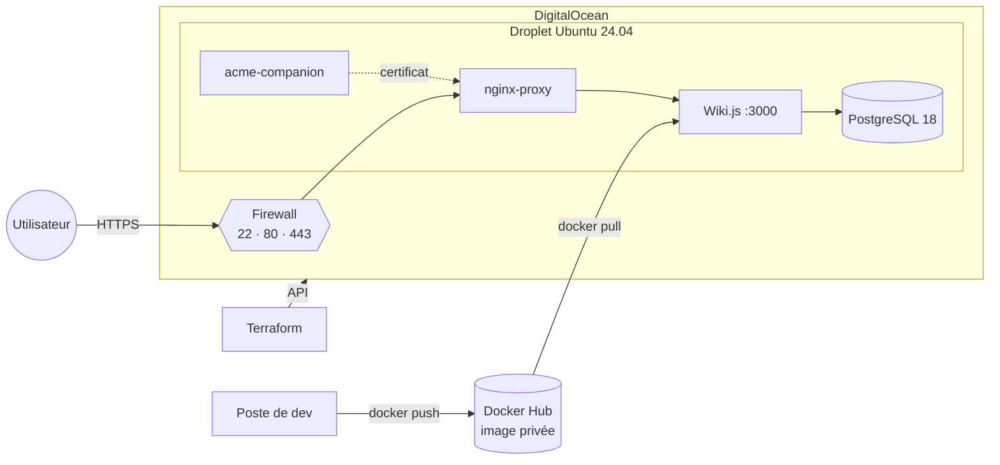

# Wikyu

Wiki.js v3 conteneurisé, déployé en HTTPS sur DigitalOcean avec Terraform.



| Fichier | Rôle |
|---|---|
| `Dockerfile` | Image Wiki.js en deux étapes (build puis exécution en non-root, `node:26-alpine`) |
| `docker-compose.yml` | Proxy HTTPS, certificats Let's Encrypt, Wiki.js et PostgreSQL |
| `terraform/` | Droplet, firewall, projet, DNS optionnel ; cloud-init installe Docker et lance le compose |

## 1. Construire l'image

Le code de Wiki.js n'est pas versionné ici, il sert de contexte de build :

```bash
git clone https://github.com/requarks/wiki.git wiki
docker build -f Dockerfile -t headwind565/dumbsumb:1 ./wiki
docker login -u headwind565
docker push headwind565/dumbsumb:1
```

Si le build s'arrête sans erreur claire, augmente la RAM allouée à Docker.

## 2. Déployer

Prérequis : Terraform ≥ 1.5, un token DigitalOcean, une clé SSH, un token Docker Hub **en lecture seule** et un domaine.

```bash
cd terraform
cp terraform.tfvars.example terraform.tfvars   # puis adapter
export DIGITALOCEAN_TOKEN="dop_v1_..."
export TF_VAR_registry_token="dckr_pat_..."
terraform init
terraform apply
```

Fais pointer le domaine vers `terraform output ipv4` (sauf si `dns_zone` est renseigné). Le wiki répond sur `https://<domaine>` quelques minutes plus tard.

Au premier démarrage, cloud-init crée l'utilisateur `ops` (root et mot de passe désactivés), écrit dans `/opt/deploy/` le compose, le `.env` et le mot de passe de la base, installe Docker, active UFW puis lance la stack.

## Exploitation

```bash
ssh ops@$(terraform output -raw ipv4)
sudo cloud-init status --wait                     # attendre la fin de l'installation
cd /opt/deploy && sudo docker compose ps          # état des services
sudo docker compose logs -f wiki                  # logs du wiki
sudo docker exec acme-companion /app/force_renew  # relancer le certificat
```

```bash
terraform output -raw db_password   # mot de passe PostgreSQL
terraform destroy                   # tout supprimer
```

⚠️ Modifier le compose ou les variables **recrée la VM** et efface les données (pour l’éviter, ajoute `lifecycle { ignore_changes = [user_data] }` au droplet dans `main.tf`).

## Dépannage

| Symptôme | Solution |
|---|---|
| `Size is not available in this region` | Changer `size` ou `region` |
| `SSH Key is already in use` | Renseigner `existing_ssh_key_name` |
| `docker: command not found` juste après l'apply | cloud-init n'a pas fini : `sudo cloud-init status --wait` |
| `pull access denied` | Vérifier `registry_username` et `TF_VAR_registry_token` |
| Site en HTTP, `NXDOMAIN` chez acme-companion | Vérifier le DNS (`dig +short <domaine> @1.1.1.1`) puis `force_renew` |
| Liens en `http://` dans Wiki.js | Mettre l'URL du site en `https://` dans l'admin Wiki.js |

## Sécurité

- `secrets/`, `.env`, `*.tfvars` et `*.tfstate` sont ignorés par git.
- Le state Terraform contient le mot de passe de la base et le token Docker Hub en clair : garde-le en lieu sûr ou utilise un backend distant.
